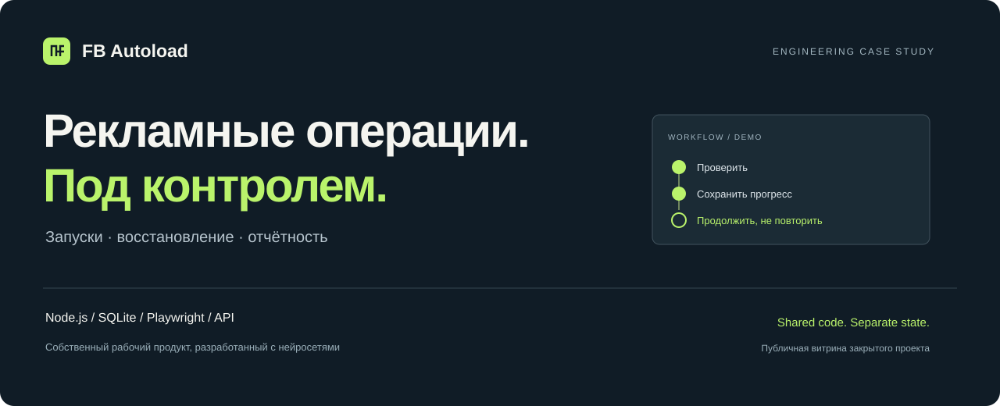

<p align="center"></p>

# FB Autoload

**Из ручных запусков рекламы — в управляемую систему с очередью, сохранённым прогрессом и проверкой результата.**

Собственный рабочий проект, разработанный с помощью нейросетей. Объединяет создание кампаний Meta, работу с медиа и каталогами, браузерные профили и отчётность по расходам и конверсиям.

Это открытая **презентация закрытого продукта**, а не исходники производственной системы. Все примеры и интерфейсы здесь демонстрационные; рабочие данные не используются.

**[Открыть интерактивную презентацию →](https://23e23e.github.io/fb-autoload-showcase/)**

В демо можно пройти обычный запуск: выбрать кампанию, добавить видео, отметить кабинеты, подтвердить план и увидеть результат по каждому кабинету. Все данные вымышлены; внешних действий и списаний нет.

**Быстрый маршрут:** [задача и решения](#не-просто-обёртка-над-api) · [архитектура](docs/engineering.md) · [исполняемый пример](dist/recovery.mjs) · [тесты](tests/recovery.test.mjs)

## Не просто обёртка над API

| Задача | Что сделано |
| --- | --- |
| Повторяющиеся ручные действия при запуске | Подготовка плана, проверка доступов и последовательное выполнение стадий: медиа → кампания → группы → объявления → проверка |
| Сеть оборвалась после создания объекта | Сохранение подтверждённых ID и сверка фактического результата перед продолжением, вместо слепого повтора |
| Два направления работают с разными системами | Общее ядро и отдельные адаптеры; раздельные процессы, базы, настройки, браузерные сессии и уведомления |
| «Задача завершена» не объясняет, что произошло | Результат по каждому рекламному кабинету; частичный запуск не выдаётся за полный успех |
| Расход и конверсии находятся в разных источниках | Сбор фактов и сопоставление по идентификаторам; неполное покрытие видно в отчёте |

Поддерживаются прямые, многоязычные и каталожные запуски. Интеграции: **Meta, AdsPower, Dolphin, Keitaro, PWA Partners, Telegram**.

## Самое интересное — поведение при сбое

API может создать кампанию, но потерять ответ. Повторить POST — риск получить дубль. Просто отметить ошибку — потерять прогресс.

В репозитории есть маленькая **исполняемая модель** этого решения: [recovery.mjs](dist/recovery.mjs). Она демонстрирует три сценария:

1. Объект однозначно найден → использовать его и продолжить недостающий этап после разрешения оператора.
2. Результат чтения неоднозначен → остановиться без новых записей.
3. Отмена уже сохранена → не возвращать задачу в работу после восстановления.

Это специально написанный учебный пример принципа, **не копия production-runner**. В нём нет сетевых вызовов и реальных подключений. Он не обещает exactly-once для внешнего API.

## Моя роль и работа с AI

Я сформулировал задачу из собственной операционной работы, определял сценарии и ограничения, проверял результат на практике и развивал продукт по обратной связи.

Нейросети использовал для исследования API, разработки кода, разбора логов и подготовки регрессионных тестов. Ключевой подход — не принимать сгенерированный код на веру: фиксировать требования, проверять конкретные сценарии и сохранять воспроизводимые результаты.

**Стек рабочего приложения:** JavaScript / Node.js · SQLite · HTML/CSS · Playwright · REST API · MCP.

## Посмотреть локально

**Без установки:** откройте `FB-Autoload.html` в браузере. Это автономная версия презентации с работающим интерактивным примером.

Для работы с исходниками нужен Node.js 20+. Установка зависимостей не требуется.

```bash
npm test
npm start
```

Для проверки исходников используйте команды выше: они пересоберут автономную версию, выполнят тесты и запустят локальный просмотр модульной страницы из `dist/`. Никакие действия в рекламных системах не выполняются.

## Что можно проверить в этом репозитории

- [Кейс и архитектурные компромиссы](docs/engineering.md).
- [Изолированную модель восстановления](dist/recovery.mjs) и её [проверки](tests/recovery.test.mjs).
- [Статическую презентацию](dist/index.html), не требующую ключей и сторонних сервисов.
- [Проверку состава публичных файлов](scripts/check-public.mjs) и [порядок публикации](PUBLISHING.md).

Производственный код, секреты, конфигурация, история задач и клиентские материалы намеренно не включены. Метрики экономии времени и роста эффективности не заявляются без измерений.
